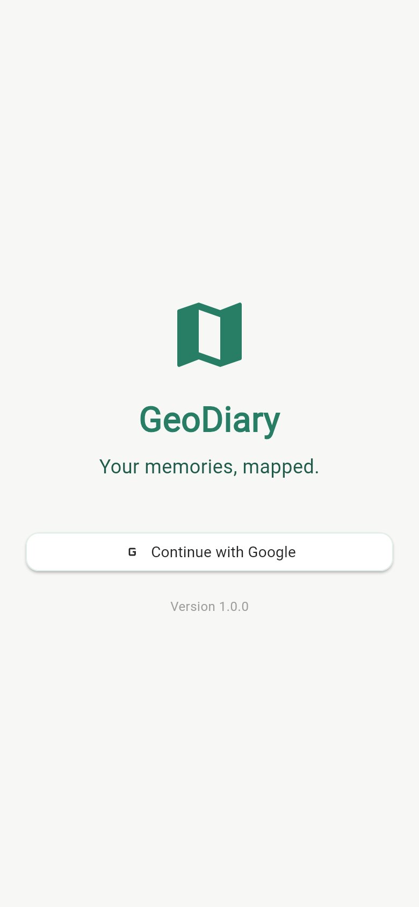
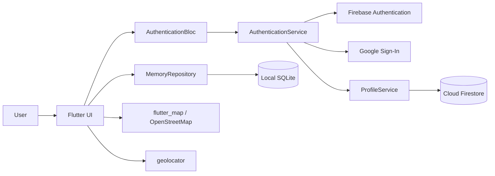

# GeoDiary

<p align="center">
  <strong>Your memories, mapped.</strong>
</p>

<p align="center">
  
  
  
  
</p>

<p align="center">
  
</p>

<p align="center">
  <em>Google Sign-In screen</em>
</p>

## Overview

GeoDiary is an offline-first Flutter journal for capturing memories with photos,
dates, GPS coordinates, and personal notes. Memories can be browsed as a
chronological journal or explored on an interactive map.

The app uses Firebase Authentication for Google Sign-In and stores memory data
locally in SQLite. Cloud Firestore is used only for lightweight user-profile
metadata. This keeps journal content private and available without an internet
connection, while still providing a familiar authenticated experience.

GeoDiary currently targets **Android** and **web**.

## Features

- Google Sign-In on Android and web
- Create, view, edit, and delete memories
- Title, description, visit date, photo, and location support
- Camera and gallery photo selection
- High-accuracy GPS capture with permission and precise-location handling
- Journal view with search and date sorting
- Interactive OpenStreetMap view with memory markers
- Local-first SQLite persistence with schema migration support
- User-profile creation and updates in Cloud Firestore
- Settings screen with account details, permission shortcuts, and sign-out
- Responsive Material 3 interface with a custom nature-inspired theme

## Tech Stack

| Area | Technology |
| --- | --- |
| Framework | Flutter 3.47.7 / Dart 3.13.5 |
| State management | `flutter_bloc`, `bloc`, `equatable` |
| Authentication | Firebase Authentication, `google_sign_in` |
| User profiles | Cloud Firestore |
| Local persistence | SQLite via `sqflite` |
| Maps | `flutter_map`, `latlong2`, OpenStreetMap |
| Location | `geolocator` |
| Images | `image_picker`, `path_provider` |
| Testing | `flutter_test`, `sqflite_common_ffi` |

## Architecture



The application follows a feature-oriented structure with a repository layer for
data access and a BLoC for authentication state.

```text
lib/
├── bloc/                     # Authentication BLoC events and states
├── core/database/            # SQLite helper and schema migrations
├── features/
│   ├── auth/                 # Google Sign-In screen
│   ├── journal/              # Memory model, repository, and journal UI
│   ├── map/                  # Map screen
│   └── settings/             # Account and app settings
├── models/                   # Firestore user-profile model
├── routes/                   # Named routes and route table
├── services/                 # Authentication and profile services
├── theme/                    # Color palette and Material 3 theme
├── firebase_options.dart     # Generated Firebase configuration
└── main.dart                 # App bootstrap and dependency wiring
```

## Getting Started

### Prerequisites

- [Flutter 3.47.7](https://docs.flutter.dev/get-started/install) (stable channel)
- Dart 3.13.5 (included with Flutter)
- Android Studio with Android SDK 36 for Android development
- A physical Android device or emulator
- Google Chrome for web development
- Node.js 18+ and npm for the Firebase CLI
- A Firebase project with Google Sign-In enabled
- A Firebase account with access to the project

Verify your environment before continuing:

```bash
flutter --version
flutter doctor
```

Resolve any Android toolchain or license issues reported by `flutter doctor`.

### 1. Clone the repository

```bash
git clone https://github.com/milandahal1000/GeoDiary.git
cd GeoDiary
```

### 2. Install dependencies

```bash
flutter pub get
```

### 3. Create and configure Firebase

1. Open the [Firebase Console](https://console.firebase.google.com/) and create
   a project (or select an existing one).
2. Add an **Android** app with the package name:

   ```text
   com.example.geodiary
   ```

   This must match `applicationId` in `android/app/build.gradle.kts`.
3. Add your debug signing fingerprint to the Android app. On Linux/macOS:

   ```bash
   keytool -list -v \
     -keystore ~/.android/debug.keystore \
     -alias androiddebugkey \
     -storepass android \
     -keypass android
   ```

   On Windows, use `%USERPROFILE%\.android\debug.keystore`. Add both the
   **SHA-1** and **SHA-256** values to the Firebase Android app settings.
4. Add a **Web** app in Firebase if you want to run GeoDiary in the browser.
5. Enable **Authentication → Sign-in method → Google**.
6. Create a **Cloud Firestore** database. GeoDiary stores user profiles at
   `users/{uid}`. A suitable starting ruleset is:

   ```text
   rules_version = '2';
   service cloud.firestore {
     match /databases/{database}/documents {
       match /users/{userId} {
         allow read, write: if request.auth != null
                            && request.auth.uid == userId;
       }
     }
   }
   ```

7. Generate the Flutter Firebase configuration. The recommended approach is
   the FlutterFire CLI:

   ```bash
   npm install -g firebase-tools
   firebase login
   dart pub global activate flutterfire_cli
   flutterfire configure \
     --project=<your-firebase-project-id> \
     --platforms=android,web
   ```

   This writes `lib/firebase_options.dart` and
   `android/app/google-services.json`.

   If the `flutterfire` command is not found, add your Dart pub cache binary
   directory to `PATH` (`~/.pub-cache/bin` on Linux/macOS, or
   `%LOCALAPPDATA%\Pub\Cache\bin` on Windows) and open a new terminal.

> **Note:** This repository contains Firebase configuration for the original
> GeoDiary project. If you do not have access to that Firebase project, generate
> your own configuration with the steps above. Never reuse another project's
> Firebase configuration for a production deployment.

If you change the Android signing key or SHA fingerprints later, download the
updated `google-services.json` again and rebuild the app.

### 4. Run the app

List available devices:

```bash
flutter devices
```

Run on a connected Android device or emulator:

```bash
flutter run
```

Run in Chrome:

```bash
flutter run -d chrome
```

For web sign-in, allow popups for `localhost`. Firebase usually authorizes
`localhost` by default; if not, add it under **Authentication → Settings →
Authorized domains** in the Firebase Console.

### 5. Build the app

Android debug APK:

```bash
flutter build apk --debug
```

Web release build:

```bash
flutter build web --release
```

To produce a Play Store bundle:

```bash
flutter build appbundle --release
```

> The repository currently uses the debug signing key for release builds. Add a
> proper release keystore and signing configuration before publishing.

### 6. Verify the project

```bash
flutter analyze
flutter test
```

The test suite covers the memory model and the local SQLite repository.

## Configuration Reference

| File | Purpose |
| --- | --- |
| `lib/firebase_options.dart` | Generated FlutterFire platform configuration |
| `android/app/google-services.json` | Firebase Android configuration |
| `android/app/src/main/AndroidManifest.xml` | Internet and location permissions |
| `android/app/build.gradle.kts` | Android package name, SDK levels, and signing |
| `pubspec.yaml` | Flutter dependencies and application metadata |
| `lib/core/database/database_helper.dart` | SQLite schema and migrations |

### Permissions

GeoDiary requests the following Android permissions:

- `INTERNET` — Firebase Authentication, Firestore, and map tiles
- `ACCESS_FINE_LOCATION` — accurate memory locations
- `ACCESS_COARSE_LOCATION` — fallback location access

Camera and photo-library access is handled by `image_picker` when the user takes
or selects a photo.

### Map tiles

The map uses OpenStreetMap tiles through `flutter_map`. The public OpenStreetMap
tile servers are intended for development and low-volume use. Review the
[OpenStreetMap tile usage policy](https://operations.osmfoundation.org/policies/tiles/)
and configure a dedicated tile provider before serving production traffic.

## Data and Privacy

| Data | Storage | Leaves the device? |
| --- | --- | --- |
| Memories, notes, photos, coordinates | Local SQLite and app documents | No |
| Name, email, photo URL, sign-in timestamps | Cloud Firestore `users/{uid}` | Yes, when signed in |
| Authentication session | Firebase Authentication | Yes |

Memories are device-local. Uninstalling the app or clearing its data removes
them permanently; there is currently no cloud backup or cross-device sync for
journal entries. Map tiles require an internet connection, but saved memories
remain available offline.

## Troubleshooting

| Symptom | Likely cause | Resolution |
| --- | --- | --- |
| `google-services.json` missing | Firebase Android app not configured | Run `flutterfire configure` or download the file from Firebase |
| `ApiException: 10` or `DEVELOPER_ERROR` | SHA-1 fingerprint mismatch | Add the debug SHA-1 to Firebase, re-download the config, and rebuild |
| `sign_in_failed` on Android | Wrong package name or signing key | Verify `com.example.geodiary` and your SHA fingerprints |
| `auth/unauthorized-domain` on web | Domain not authorized | Add the domain under Firebase Authentication settings |
| Google popup closes immediately | Popup blocked by the browser | Allow popups for `localhost` or your deployed domain |
| Location is approximate or unavailable | Precise location disabled | Enable precise location for GeoDiary in Android settings |
| Map tiles do not load | No internet connection | Reconnect to load OpenStreetMap tiles |
| `[core/no-app]` Firebase error | Firebase failed to initialize | Regenerate `firebase_options.dart` and verify the platform configuration |

## Roadmap

- Export and import for local memories
- Optional encrypted cloud backup
- Cross-device memory synchronization
- Reverse geocoding for human-readable addresses
- iOS support
- Expanded integration and widget tests

## Contributing

1. Create a feature branch:

   ```bash
   git checkout -b feature/your-feature
   ```

2. Make your changes and run:

   ```bash
   dart format lib test
   flutter analyze
   flutter test
   ```

3. Commit your changes and open a pull request describing the change and how it
   was tested.

## Acknowledgements

- [Flutter](https://flutter.dev/)
- [Firebase](https://firebase.google.com/)
- [OpenStreetMap](https://www.openstreetmap.org/)
- [flutter_map](https://pub.dev/packages/flutter_map)
- [geolocator](https://pub.dev/packages/geolocator)
- [sqflite](https://pub.dev/packages/sqflite)
